

  

  
  
  
  

---

  

  
  
  

  

  
  

<!-- 1. 3D Isometric Profile Contribution Calendar -->

  

  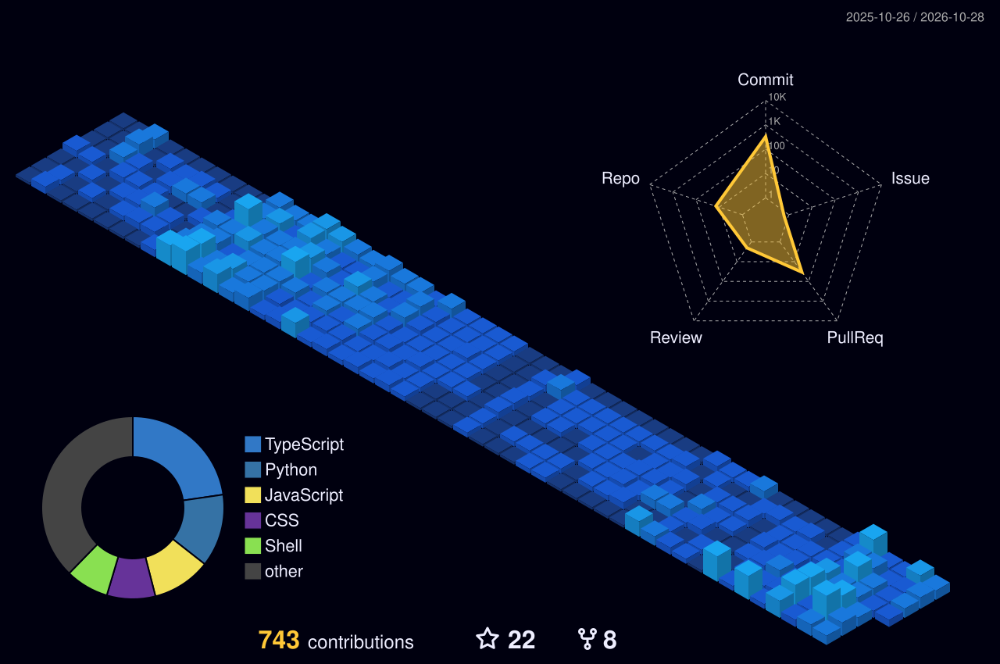

<!-- 2. Animated Contribution Grid Snake -->

  

  

<!-- 3. Pull Requests & Open-Source Impact -->

  

  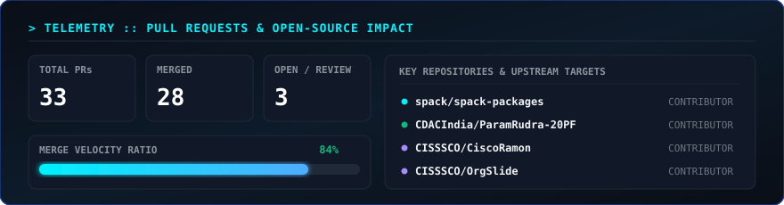

<!-- 4. Most Used Languages & Codebase Distribution -->

  

  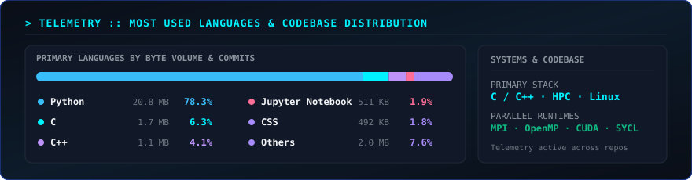

<!-- 5. Live Real-Time Activity Feed -->

  

  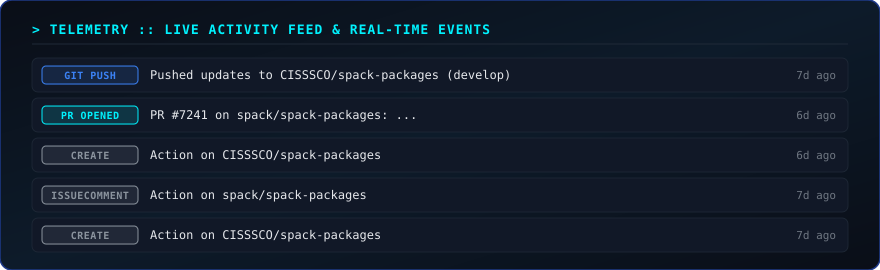

<!-- 6. 24-Hour Commit Cadence & Coding Habits -->

  

  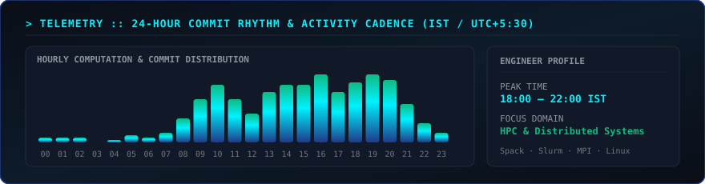

---

  

  I’m an HPC &amp; Linux systems engineer working where <b>high-performance computing</b>, <b>parallel programming</b>, and <b>scientific software</b> meet. I write scalable Linux applications, tune parallel distributed workloads on supercomputers (PARAM Shivay &amp; PARAM Rudra), and contribute to upstream scientific tooling like Spack.

  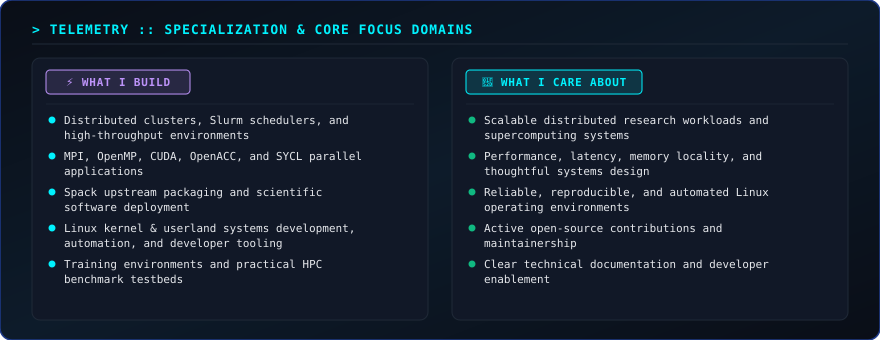

---

  

  

  
  
  
  
  
  

  
  
  
  
  
  
  

---

  

  <a href="https://github.com/CISSSCO/OrgSlide">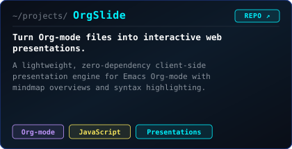</a>
  <a href="https://github.com/CISSSCO/HPCCFS">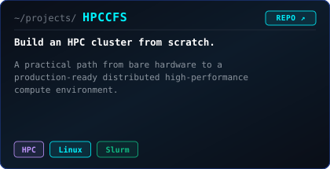</a>

  <a href="https://github.com/CISSSCO/playlisto">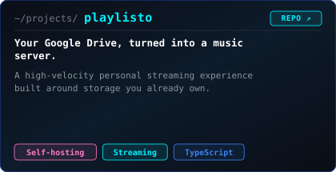</a>
  <a href="https://github.com/CISSSCO/cerrfix">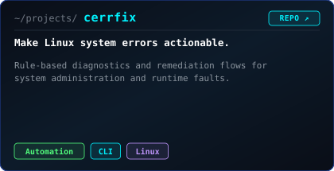</a>

  <a href="https://github.com/CISSSCO/GitPush">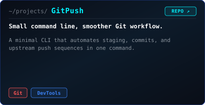</a>
  <a href="https://github.com/CISSSCO/CiscoRamon">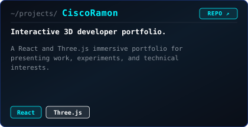</a>

  
  

---

  

  <a href="https://ciscoramon.netlify.app">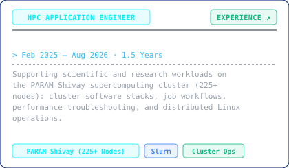</a>
  <a href="https://ciscoramon.netlify.app">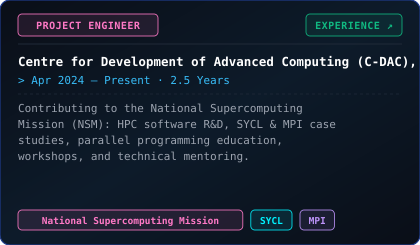</a>

---

  

